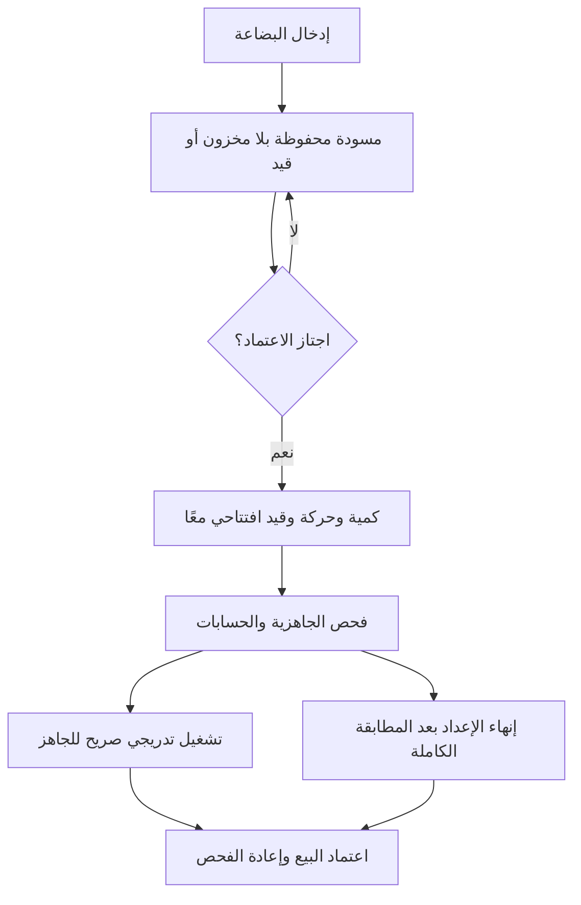

# ما الفرق بين إدخال البضاعة واعتمادها وفتح البيع؟

تاريخ المراجعة: 2026-11-10. هذا شرح للكود الحالي وتشخيص محتمل للتاريخ، وليس فحصًا أو إصلاحًا للمستندات `OS-000001` إلى `OS-000031`. لم يُقرأ أي سجل من قاعدة العميل.

## ستة أشياء مختلفة

| المصطلح | ماذا يعني لصاحب المحل؟ | أثر الكود الحالي | ماذا لا يثبت؟ |
|---|---|---|---|
| تعريف منتج | اسم وتصنيف ولون ومقاس وسعر وصورة | `products` و`product_variants` والصور | لا كمية أو قيد أو نشر بالموقع |
| حفظ مسودة البضاعة | حفظ ما أدخلته لتراجعه لاحقًا | مستند `opening_stock_entries` بحالة `draft` وبنوده وتعريفات المنتج اللازمة | لا `inventories` أو `stock_movements` أو قيد افتتاحي |
| اعتماد المستند | إثبات الرصيد الافتتاحي المحدد للفرع | مخزون وحركات وقيد `opening` وحالة `approved` وتدقيق، ضمن معاملة الاعتماد | لا دين مورد أو دفع نقد أو إغلاق إعداد أو تفعيل بيع |
| ظهور الكمية | يوجد رصيد مخزني مسجل | صف Inventory قد يكون مصدره افتتاحًا أو شراءً أو نقل بيانات قديم | لا يثبت وحده مصدر القيمة أو صحة القيد |
| اكتمال الجاهزية | الكمية والقيمة والحركات والمصادر والحسابات متطابقة وفق الفحوص | تقرير يبين أسباب المنع وإمكانية الإنهاء؛ التدريجي يفحص جاهزية الصنف أيضًا | لا يشهد على ديون أو نقد خارج التطبيق لم يدخله المالك |
| السماح بالبيع | تحقق التهيئة المركزية ووضع الفرع والصنف والحساب والصلاحيات | اعتماد عبر خدمات البيع المشتركة يعيد الفحص تحت الأقفال | لا ينتج عن رقم OS أو نجاح الحفظ فقط |

المصادر: [PostOpeningStockAction::execute](../app/Actions/Inventory/OpeningStock/PostOpeningStockAction.php)، [ManageOpeningDraftAction::approve](../app/Actions/Inventory/OpeningStock/ManageOpeningDraftAction.php)، [SetupReadinessReport::build](../app/Actions/Inventory/SetupReadinessReport.php)، [ProgressiveOperation::assertBranch/assertStocks/assertAccounts](../app/Actions/Inventory/ProgressiveOperation.php)، [PostSaleAction::execute](../app/Actions/Sales/PostSaleAction.php).

التهيئة المركزية `sales_controls.activated_at` شرط مستقل إضافي. يعالجها مسار المسؤول الحالي، ولا يضبطها اعتماد البضاعة أو إنشاء المالك. [SetupSalesCommand::handle](../app/Console/Commands/Sales/SetupSalesCommand.php)، [OperationContext::ready](../app/Support/Sales/OperationContext.php).

## ماذا يفعل القيد الصحيح؟

مثال جديد معزول: 3 قطع × تكلفة 12.50 = 37.50. اعتماد الافتتاح يسجل مدين `inventory` بقيمة 37.50 ودائن `opening_equity` بقيمتها. لا يسجل موردًا أو صندوقًا. تكلفة الرصيد ليست سعر البيع ولا الحد الأدنى للبيع.

`ManageOpeningDraftAction::approve` يقفل المصدر والفرع ويستعمل القفل المشترك، يتحقق من الإصدار والتكرار والإجماليات والحسابات، ثم ينفذ المخزون والحركة والقيد والتدقيق. فشل أي منها يتراجع عن آثار الاعتماد كلها. أما حفظ المسودة السابق فهو معاملة مستقلة مقصودة؛ قد تبقى مسودة سليمة بعد فشل الاعتماد. لذلك لا تكتف برسالة حفظ أو HTTP 200/201: راجع **الحالة**.

مسار «اعتماد البضاعة» المباشر في `PostOpeningStockAction::execute` يحفظ مسودة أولًا ثم يفوض الاعتماد إلى الخدمة نفسها. عند الفشل يعلّم النتيجة `approval_pending` ويعيد المستند للمراجعة، ولا يصنع كمية بلا قيد. المستند المعتمد سابقًا لا يعاد ترحيله لمعالجة نقص تاريخي.

## لماذا قد توجد OS-000001 … OS-000031 بلا قيد؟

هذه **احتمالات مدعومة بمسارات كود**، وليست نتائج عن مستندات العميل:

1. **قد تكون مسودات.** الترقيم مشتق من معرف المستند، ويظهر للمسودة أيضًا. وجود رقم أو سعر أو بنود لا يعني الاعتماد. راجع [OpeningStockEntry::getNumberAttribute](../app/Models/OpeningStockEntry.php).
2. **قد تكون معتمدة بإصدار سابق كان يرحّل المخزون فقط عند عدم تهيئة المبيعات.** النسخة السابقة للملف الظاهرة في `git diff` لهذا العمل كانت تربط إنشاء القيد بوجود `actorId` و`activated_at`، رغم إنشاء المخزون والحركات خارج ذلك الشرط. الإصلاح المحلي الحالي أزال هذا الفصل. هذا يثبت إمكانية المسار القديم، ولا يثبت أي إصدار استُخدم لهذه الأرقام أو أنه منشور الآن.
3. **قد تكون منقولة من النظام القديم.** [DataMigrationSeeder::migrateInventory](../database/seeders/DataMigrationSeeder.php) ينسخ `inventories` ومستندات الافتتاح وبنودها وحركاتها مباشرة ويحسب قيمة الرصيد، ولا يستدعي اعتماد الافتتاح الحالي. `smartDefault` قد يضع `approved` إذا احتاج حقل حالة مفقودًا. لم نجد إنشاء قيود افتتاحية مقابلة ضمن هذا المسار. لم نشغّل Seeder ولم نتصل بالمصدر القديم، ولا نثبت أنه سبب هذه المستندات تحديدًا.
4. **قد يوجد قيد لكن الربط/الفرع/الحدث/العكس لا يجعله دليلًا صالحًا.** يلزم فحص البيانات: رأس قيد فارغ أو قيد معكوس أو مصدر مختلف ليس دعمًا ماليًا كافيًا.

**مثبت من الكود:** منع إعادة اعتماد التاريخ تلقائيًا والحماية الحالية. **يحتاج فحص بيانات فعلية:** حالة كل واحد من الأرقام الـ31 وتاريخه ومصدره وقيده الصحيح. لا يمكن اعتماد الرقم التاريخي لفرق 250 أو أي رقم من تقرير قديم باعتباره فرق اليوم دون قراءة مستقلة معتمدة.

## كيف يُشخّص المسؤول دون تغيير البيانات؟

يبدأ من `/inventory/readiness` ومن المستند نفسه، ثم يطابق للقراءة فقط:

| الدليل | ما يجب مطابقته؟ |
|---|---|
| المستند | المعرف والرقم والحالة والفرع والتاريخ والمعتمد والإجماليات والإصدار |
| البنود | Variant والكمية والتكلفة وإجمالي السطر ومجموع المستند |
| الحركة | `source_type` هو بند الافتتاح `OpeningStockItem` و`source_id` معرف البند؛ الفرع والكمية والقيمة والتاريخ |
| القيد الأصلي | `source_type` هو المستند `OpeningStockEntry` و`source_id` معرف المستند و`event=opening`؛ الفرع والتاريخ والحسابان والمبلغ |
| التاريخ اللاحق | عكس القيد، تصحيحات `InventorySetupChange` وقيود `opening_correction`، شراء/بيع/مرتجع أو حركات أخرى |
| النتيجة | مطابقة الرصيد الحالي بالحركات والدفتر دون إعادة استقبال البضاعة أو افتراض أن معرف الحركة يساوي معرف المستند |

المصدر: [OpeningFinancialSupport::assertValid/matches](../app/Actions/Inventory/OpeningStock/OpeningFinancialSupport.php)، [ProgressiveStockProof::build](../app/Actions/Inventory/ProgressiveStockProof.php)، `SetupReadinessReport::build`. هذا جدول فحص مقترح، ولم تُنفذ استعلاماته على بيانات العميل.

## التصحيح والإغلاق ليسا علاجًا تلقائيًا للماضي

- التصحيح الحالي في [CorrectInventoryAction::mutate](../app/Actions/Inventory/Setup/CorrectInventoryAction.php) يثبت القيد الأصلي وسلسلة تصحيحاته قبل تغيير كمية/تكلفة/حذف افتتاحي. يسجل فرق القيمة بدقة داخل Transaction مع باقي الأثر، سواء كانت تهيئة المبيعات مفعلة أو غير مفعلة. لا يسمح لمستند بلا قيد داعم أن يزيد فرق المخزون والدفتر.
- تغيير التكلفة وحدها قد يغير القيمة؛ فرق التصحيح ليس فرق كمية فقط. القيد الأصلي محفوظ، والقيد الجديد للفرق الحالي الموثق.
- يمنع التصحيح المباشر بعد التشغيل التدريجي أو إغلاق الإعداد أو عند حركات لاحقة غير آمنة. هذه حماية لتكلفة البيع السابقة، وليست زرًا مفقودًا يُتجاوز بتحرير الجدول.
- اعتماد دليل قيمة `baseline` من الجاهزية **لا ينشئ القيد المالي الناقص**. وإغلاق الإعداد يحفظ لقطة واعتماد شمول الأرصدة، ولا يسجل تسوية للفرق. [ReviewInventoryAction::baseline/close](../app/Actions/Inventory/ReviewInventoryAction.php).
- مراجعة الانتقال المالي `/finance/transition` تكشف مصادر النقص، وتنفيذ انتقال تاريخي له حارس إعداد وصلاحيات ودليل وموافقة مستقلة. وجود هذه الشاشة لا يأذن بإصلاح الـ31 مستندًا. [LegacyFinanceTransitionAction](../app/Actions/Finance/LegacyFinanceTransitionAction.php).

## الفرق عن شراء جديد

البضاعة الموجودة عند بداية العمل تدخل افتتاحيًا مرة واحدة للتركيبة والفرع. البضاعة التي اشتريتها الآن تدخل فاتورة شراء: مورد ومسودة ثم اعتماد استلام وقيد مخزون مقابل ذمة مورد، والدفع سند مستقل أو دفعة مصرح بها عند الاعتماد. هذا يحافظ على طريقة تقييم الرصيد القائمة؛ لا FIFO جديد. [ApprovePurchaseInvoiceAction::execute](../app/Actions/Purchases/ApprovePurchaseInvoiceAction.php)، [StockLedger::cost](../app/Actions/Inventory/StockLedger.php).

للمالك: راجع [اليوم الأول](appstore-owner-first-day.md). للمطوّرة: لا تنقل التعديلات المحلية إلى إصدار ناقص الملفات، ولا تستخدم إعادة إرسال OS أو كود منتج جديد أو UUID جديد بوصفه إصلاحًا ماليًا.
