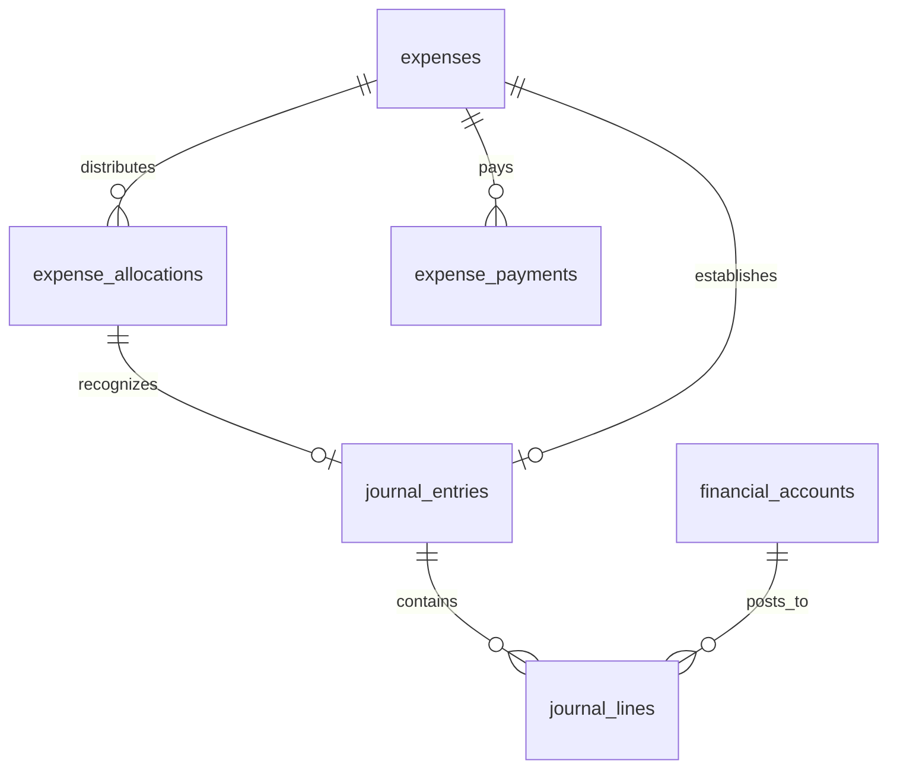

# تصميم المصروفات متعددة الأشهر

## الفجوة المثبتة قبل التنفيذ

`ManageExpenseAction::save` في `app/Actions/Finance/Expenses/ManageExpenseAction.php` يرفض امتداد الفترة خارج الشهر الواحد. دورة الاعتماد والدفع منفصلة أصلًا: الاعتماد مدين `operating_expenses` ودائن `expense_payables`، ثم الدفع مدين المستحق ودائن الحساب الفعلي. لذلك يمكن إضافة توزيع الاستفادة دون نظام دفع أو دفتر موازٍ. تصنيف الكهرباء والإيجار حاليًا وصف للمصروف؛ كلاهما يرحل إلى `operating_expenses`، ولا يغير إنشاء حساب جديد في الشجرة هذا الربط.

## التصميم المنفذ وحدود الموافقة

نُفذ التصميم التالي في الملفات المحلية، وطُبق ترحيله الجديد على `appstore_golive_20261031_tests` فقط. لم يطبق على `app_store` أو Testing أو Production، ولم يعالج مصروفًا تاريخيًا. الميزة تظل محجوبة عند غياب جدولها؛ المصروف المباشر القديم لا يحتاج جدول توزيع ليعمل.

- استخدام `expenses` نفسه مع `recognition_method` افتراضي `immediate`؛ القديم لا يعاد تصنيفه ولا يُنشأ له جدول تلقائيًا.
- جدول `expense_allocations`: مصروف، شهر، بداية/نهاية الاستفادة داخل الشهر، تاريخ استحقاق الحصة، مبلغ بالوحدات الصغرى، وقت الترحيل. مفتاح فريد `(expense_id, month)`، وقيد دفتر فريد لكل مصدر/حدث عبر البنية الحالية.
- `prepaid_expenses` حساب أصل مستقل ينشأ عند اعتماد مستند جديد متعدد الأشهر فقط، دون تعديل الحسابات القائمة أو إضافة شرط جاهزية شامل على المحلات التي لا تستخدم الميزة.
- اعتماد متعدد الأشهر: مدين الأصل ودائن `expense_payables`. لا نقد عند الاعتماد. الدفع الفعلي عبر `ExpensePayment` القائم، مرة واحدة لكل UUID، ويمكن أن يكون جزئيًا.
- الاعتراف: مدين `operating_expenses` ودائن الأصل، مع بُعد `expense_id` لتقرير التصنيف. الحصة تستحق عند نهاية فترة الاستفادة الشهرية؛ لا ترحيل لمستقبل.
- الأشهر الكاملة متساوية. عند وجود أشهر جزئية، الوزن لكل شهر = أيام الاستفادة ÷ أيام الشهر. تستخدم أوزانًا صحيحة بمقام مشترك، ثم توزيع الوحدات الصغرى المتبقية بصورة حتمية، دون `float`؛ المجموع يساوي مبلغ الفاتورة تمامًا.
- تاريخ إثبات الأصل لا يأتي بعد بداية الاستفادة في هذا المسار. المستند المتأخر الذي يخالف ذلك يحتاج مراجعة مستقلة، ولا تُنشأ له قيود رجعية بصمت.
- Scheduler يعالج المستندات المعتمدة الجديدة فقط، بهوية المعتمد وصلاحياته الحالية ونطاق الفرع. كل مصروف داخل Transaction والقفل المشترك وقفل صفه. الفترة المغلقة تترك الحصة معلقة مع سبب واضح؛ لا نقل تاريخها إلى اليوم لإخفاء التأخير.
- تعديل المسودة يكون بالإلغاء وإعادة الإدخال؛ لا تحرير لجدول معتمد. الإلغاء المعتمد يعكس الدفعات أولًا، ثم حصص الاعتراف وقيد الأصل بقيود عكس بتاريخ اليوم المفتوح. لا حذف لقيود تاريخية. الاسترداد الجزئي أو تغيير العقد بعد الاعتراف يحتاج مسارًا مستقلًا؛ لا تقريب محاسبي مرتجل.
- التقارير تعتمد القيود، لا مجموع الفاتورة بوصفه مصروف الشهر. الدفعات الفعلية وحدها تمثل التدفق النقدي. تقرير الجدول يفصل المجدول والمعترف به والمدفوع والمستحق وأصل الاستفادة المتبقي.
- حصة مستحقة غير مرحلة تمنع اعتبار التقرير مكتملًا وإنهاء الإعداد للفرع. هذا الشرط لا يدعي اكتمال بقية الإيرادات أو COGS أو الأرصدة القديمة.

## قائمة القبول

غطت اختبارات MySQL المعزولة: 12 شهرًا، عبور سنة، أجزاء شهر وفروق تقريب، مسودة بلا قيد، اعتماد دون دفع، دفعة وإعادة طلب دون تكرار، Catch-up، منع فترة مغلقة، فشل القيد والتراجع، تكرار الاعتراف، عكس كامل، صلاحية وفرع، المصروف المباشر القديم، كشف جدول تغير بعد الاعتماد أو مصدر معكوس وسحب صلاحية المعتمد. أضيفت اختبارات Unit للتوزيع ويوم الكبيسة والمبلغ الكبير. التفاصيل والأرقام النهائية في [تقرير التنفيذ](appstore-pricing-and-purchasing-review.md).

نجح سباق MySQL حقيقي بعمليتي PHP مستقلتين عبر `AuditMySqlConcurrencyTest::test_mysql_prepaid_recognition_is_once_under_two_real_processes`: الطلبان ينجحان، وحصة واحدة وقيد واحد ودون دفعات. لا يثبت ذلك اختبار كل سباق ممكن، مثل الاعتراف المتزامن مع عكس العقد؛ كلا المسارين يستعمل القفل المشترك وصف المصروف، لكن يلزم توسيع اختبار السباق لهذا الاقتران لاحقًا.

## الاستخدام والصلاحيات والتقارير

من `/finance/expenses` اختر طريقة احتساب متعددة الأشهر ثم احفظ المسودة، وراجع جدولها من تفاصيلها قبل الاعتماد. الاعتماد بـ`finance.expenses.approve`، والدفع بـ`finance.expenses.pay`، والعكس بـ`finance.reverse`، والعرض بـ`finance.view`، مع نطاق الفرع في الخدمة. لا دور أو إذن يمنح تلقائيًا. `app:expenses-recognize` يوميًا الساعة00:10 عبر Scheduler؛ يتطلب تشغيل Cron الخاص بالنسخة عند نشر معتمد، ولم يُضبط أي Cron حقيقي هنا.

`/finance/expenses/report` يعرض المعترف به والمدفوع والأصل المتبقي والتصنيفات للفترة، مع HTML وJSON وExcel. يستخدم القيود وأبعاد `expense_id` نفسها، ويحتسب العكس بتاريخ قيده. `FinanceReports::completeness` و`SetupReadinessReport` يكشفان الحصص المتأخرة. أصل الاستفادة يظهر في شجرة الحسابات، ولم تضف ميزانية عمومية كاملة أو واجهة جديدة لإغلاق فترة مالية.

## غير المكتمل والممنوع تلقائيًا

لا تعديل عقد جزئي بعد الاعتماد أو استرداد جزء اعتباطي من سند أو إعادة توزيع تاريخ مغلق. المسودة تلغى وتعاد صحيحة؛ العكس الكامل موثق بعد عكس دفعاته. الأجزاء الأخرى تحتاج مستند Adjustment/Credit بموافقات وأثر ضريبي/محاسبي مدروس إذا لزم؛ لا تحويل تلقائي للتاريخ ولا إنشاء دفعات وهمية. الفاتورة التي يأتي إثباتها بعد بداية الاستفادة تُرفض في هذا المسار؛ لم يضف مسار إثبات متأخر.

التصنيف `rent/utilities/...` يحتفظ بالربط الحالي بـ`operating_expenses`؛ لا توزيع تلقائي على حسابات يضيفها المستخدم في الشجرة. لا ادعاء بشمول ضرائب أو إهلاك أو COGS غير مكتمل أو ذمم خارج التطبيق. قبول Linux/PHP-FPM وCron وExcel/متصفح فعلي وتطبيق Flutter ما زال مستقلًا عن اختبارات الخادم.
